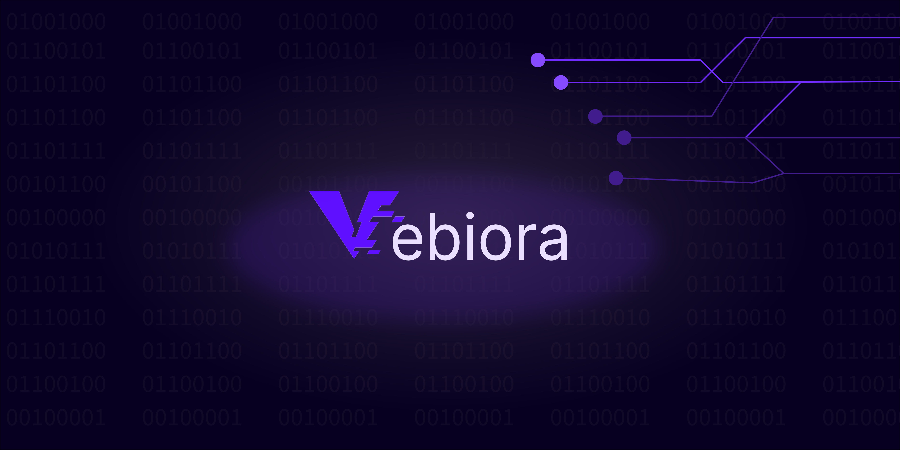

# Vebiora-ai: An AI-agent.

Vebiora is a software that turns an AI intro an agent (using API) with powerfull tools.

**!! Tools are still under development !!**

## Table of Contents

- [Features](#features)
- [Installation Instructions](#Installation-Instructions)
- [Uninstallation Instruction](#Uninstallation-Instructions)
- [FAQ](#faq)

## Features

- API changer seemlessy.
- Highly customizable.
- One File Settings.

##  Installation Instructions
Chose Your Instllataion method:
- [Manual]
- [install.py]
- [zip]
