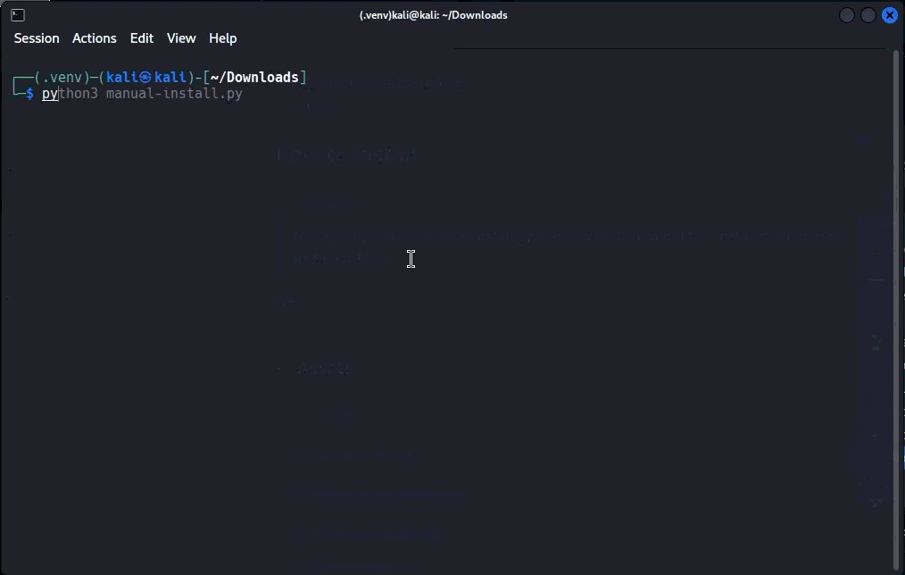

# Vebiora AI – An AI Agent

Vebiora is software that transforms an AI model into an AI agent using an API and a collection of powerful tools.

**!! Tools are still under development !!**

## Table of Contents

- [Features](#features)
- [Installation Instructions](#installation-instructions)
  - [Manual Installation](#manual-installation)
  - [ZIP Installation](#zip-installation)
- [Uninstallation Instructions](#uninstallation-instructions)
- [FAQ](#faq)

## Features

- Seamless API switching.
- Highly customizable.
- Single-file configuration.

## Installation Instructions

Choose your preferred installation method:

- [Manual Installation](#manual-installation)
- [ZIP Installation](#zip-installation)

### Manual Installation

1. Download `manual.zip` from the [latest release](../../releases/latest).
2. Follow our gif.

3. Create a environment (recommended) using `python3 -m venv .venv`. Then activate it using `source .venv/bin/activate`.
4. Install the required dependencies: `pip install -r requirements.txt`.

### Zip Installation

1. Download `vebiora_porable.zip` from the latest release.
2. extract the ZIP archive and activate it's environment: `source .venv/bin/activate`.

## uninstallation instructions

Follow the instruction based on how you installed your vebiora.

- [Manual](#manual-uninstall)
- [zip](#zip-uninstall)

### Manual uninstall

1. Delete `manual.zip`
2. Delete Your Vebiora directory ex: `~/Vebiora_ai`.

### Zip uninstall

1. Delete `vebiora_portable.zip`.
